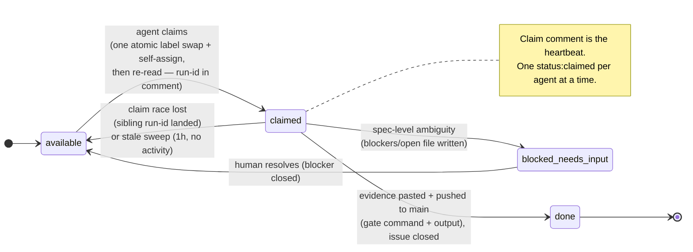
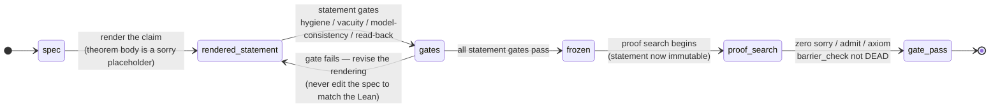
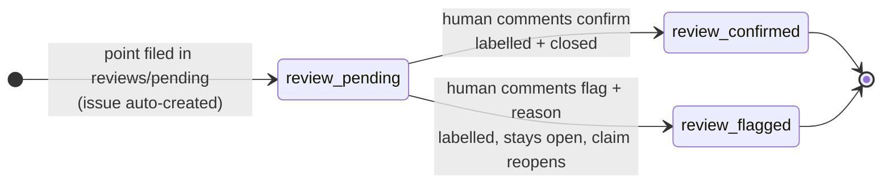

# MULTI_AGENT_WORKFLOW.md — GitHub-issue task coordination for PleaNP

How OpenHands agents (and external contributors) find, claim, and complete work
on PleaNP. One task = one GitHub issue. This protocol is adapted from the
**muse** repo's `muse/TASK_WORKFLOW.md` (2026-09-06), which has been battle-tested
for multi-agent coordination under a shared GitHub identity. PleaNP keeps
muse's core mechanics (run-ids, atomic label claims, blockers, sweeps) and
adds PleaNP-specific rules: the **integrity gates** are mandatory for any
formal claim, and **community contributions** (Zulip) enter through the same
issue queue.

> **System of record:** the issue queue plus `git log origin/main`. Status
> tables in docs (ROADMAP.md etc.) are caches updated by sweeps and may lag —
> check the queue and dev history before concluding work is undone.

## Why this exists

PleaNP's work is inherently multi-agent: the rung ladder (ROADMAP.md) has many
independent, gated tasks, and agents run in parallel against the same repo
under a shared GitHub identity. Without a coordination protocol, agents
double-claim, strand dependents, and lose work at rebase. This file is the
protocol. It is the same pattern that made muse's W/S/P/C/L pipeline work.

## Run-ids

Every agent session generates a **run-id** at session start:
`<YYYYMMDD-HHMM>-<4 random alphanumerics>` (e.g. `20260906-1530-a1b2`). The
run-id appears in every claim comment, done comment, and blocker the session
writes. It is the only way to distinguish claims under a shared GitHub
identity — all agents authenticate as the same account, so labels, assignees,
and author fields cannot tell claims apart. Without run-ids the re-fetch
check in §Claiming has no teeth.

## Task states (labels)

| Label | Meaning |
|---|---|
| `status:available` | Ready to be claimed. All blockers are `done`. |
| `status:claimed` | An agent has claimed it. Claim comment is the heartbeat. |
| `status:done` | Work committed to `main`. The human reviews on `dev` at leisure; anything needing changes spawns a follow-up task. |
| `status:blocked-needs-input` | Agent could not start or finish; needs human input. |
| `priority:high` | Jumps the work queue (default order is lowest issue number). |
| `community-ready` | Good first contribution for external/Zulip community members. |
| `needs-gate` | Requires integrity-gate review before acceptance (see §Gates). |

## Lifecycle diagrams

Two machines are described in prose above and in `docs/STATEMENTS/LOCAL_AGENT_WORKFLOW.md`.
They are drawn here so the transitions — including the `review:confirmed` /
`review:flagged` replies handled by `.github/workflows/review-issue.yml` — can be
read at a glance rather than reconstructed from the text.

### Task lifecycle (issue labels)



### Proof / claim lifecycle (statement freeze before proof search)



### Review replies (`review-issue.yml`)

Review issues carry `review:pending` and **no `status:` label by design**, so the
claim protocol never picks them up. The human answers with a comment, and the
workflow applies the transition.



## Task definition

Each issue contains:

- **Summary** — what to build, in one paragraph
- **Definition of done** — the observable end state (files written, checks passing, gate evidence)
- **Context** — links to spec sections, prior art, or related tasks the agent needs
- **Blocked by** — native GitHub issue-blocking relationships forming the lineage

**Documentation deliverable.** Every code task produces a `.md` doc alongside
its code: a README in the module's directory (usage, API, dependencies) plus a
test spec in `docs/STATEMENTS/` or `lean/tests/`. The doc is part of the
Definition of Done, not an afterthought.

Sizing rule: one task = completable in **one agent run**. Note what a run now
means: scheduled OpenHands automation runs are hard-capped at **30 minutes
wall-clock**, and a run killed at the cap loses everything not already pushed.
Recon, cloning, and gates consume a large share of that, so **size a task for 20
minutes of work or less**. If a task can't be done in one run, decompose it
before it becomes `available`.

**Planning and research are legitimate tasks, not overhead.** When an issue is
too large or too uncertain to implement in a single run, the right decomposition
is usually a research or planning issue *first* — an investigation whose
Definition of Done is a written finding, a decision record, or a freshly filed
set of smaller issues. A 20-minute run that produces a well-scoped plan for the
next five issues is a good outcome, not a wasted run. Prefer a short, honest
research task over a half-finished implementation.

## Automated runs (bounded, 30-minute cap)

Some `status:available` work is picked up by a scheduled automation rather than
an attended agent. Those runs are hard-capped at **30 minutes** — the platform
rejects any longer timeout — and a run killed at the cap loses everything not
already pushed to GitHub. Three rules follow. Attended agents should follow them
too, because the loss mode is identical.

1. **Push constantly.** Commit and push each coherent step the moment it exists.
   Unpushed work dies with the sandbox; a pushed partial commit is a resumable
   checkpoint. Do not accumulate local edits and push once at the end.
2. **Checkpoint rather than overrun.** If a run cannot finish, push what is
   complete, then post a comment beginning `<!-- oh-agent -->` `CHECKPOINT`
   naming the run-id, the pushed SHAs, what is done, what remains, and the next
   concrete step. Release the claim (restore `status:available`) so the next run
   can pick it up immediately. A run that claims an issue whose last comment is a
   `CHECKPOINT` should **continue that work, not re-derive it**. Never use
   `status:blocked-needs-input` for mere time exhaustion — that label means a
   human decision is required.
3. **Mark every agent comment with `<!-- oh-agent -->`.** Claim comments,
   progress notes, checkpoints, and closing comments alike. This is a
   machine-readable marker, not decoration: an automation watches issue comments
   and would otherwise wake on agent output and spend an entire run deciding to
   do nothing. Omitting it costs a run.

## Writing for the human reviewer

Most issues are resolved without the human reading anything, but every so often
one stops and waits for a person. When that happens, write for someone who has
not read the thread. Two conventions make the human's queue scannable without
anyone spending an agent run to summarise it.

**1. `NEEDS:` — open every `status:blocked-needs-input` comment with it.**

The comment's **first line** must be a single self-contained statement of the one
thing a human must decide or provide:

```
NEEDS: choose whether the detector statistic is re-derived per-rung or once
globally — DEC-030 implies per-rung but the ledger records a single value.
```

Rules for that line:

- One decision or one piece of information. Not two.
- Self-contained: it must make sense to a reader who has read nothing else.
  A pointer ("see above", "as discussed") is not a `NEEDS:` line.
- Say what you already know and where the ambiguity is, so the human can answer
  in one message rather than asking a clarifying question.

This is what makes the whole blocker queue readable in one command — see
a needs-audit.sh script in this repo's tooling, or the recipe in
an automations/HUMAN_REVIEW.md file (both planned, not yet built). A blocked comment without a `NEEDS:` line is
considered incomplete.

**2. "Not in my lane" — one line on your final comment, when you saw something.**

When a run finishes, if while working it noticed something outside its own task
that it did **not** act on, append one line:

```
Not in my lane: ephapse #21 needs a dependency decision; PleaNP #96 looks like
a duplicate of #77.
```

Only if true — never manufacture items to fill it. This costs nothing beyond a
line on a comment already being written, and it makes the human's periodic scan
surface cross-cutting problems that no single task owns. It is **not** a sweep:
do not go looking for things to report, and never let it extend a run.

**Multi-run tasks (adopted 2026-09-12, DEC-023 constraint-density
learnings — see `docs/LEAN_FORMALIZATION_LESSONS_2026-09-10.md` §4/§6).** Tasks
that are honest multi-run epics (parity ∉ AC⁰, Williams transfer, Natural
Proofs, full proof paths) must NOT be compressed into a single oversized claim.
Adopt an iterative pass decomposition **at issue-body level before the claim
starts**: the issue body lists `Pass 1 → Pass n` with the concrete end-state
and done-evidence for each pass, each pass sized to a run, and the done
comment records which pass was completed and what the next pass is. This
mirrors the OpenAI Navier-Stokes pattern — long-horizon targets worked as
successive sessions with intermediate checkpoints — while keeping PleaNP's
*claim-sized* agents (DEC-022 anti-pattern: precision over parallelism).

The rule, made airtight (each requirement is a hard DoD of claiming a
multi-pass issue):

1. **Effort says what it means.** The `**Effort:**` line's max is the number
   of enumerated `Pass N —` lines in the same body (each pass = one run). If
   they disagree, fix the Effort line, not the pass list — a claim on an
   inconsistent issue is void until it is consistent.
2. **One claim = one pass.** Do NOT claim a multi-pass issue "whole." The
   claim comment MUST name the pass (`claiming Pass 2 of #NN`). The one-claim
   rule applies to passes exactly as to issues: a claimed pass is the single
   `status:claimed` you may hold.
3. **A pass is done when its end-state is done.** A pass-complete commit is a
   normal commit on `main` — it closes only that pass (its own gate evidence
   in the done comment). The *issue* stays open until its final pass reports
   the full gate evidence.
4. **A pass may only land on the issue's own precedents.** A later pass is
   not claimable until its prerequisite passes have landed (same lineage
   logic as `Blocked by` — the pass list is a micro-lineage within the issue).
5. **Pass order is load-bearing.** Working pass 3 before pass 1 is a process
   violation, just like working a task whose blocker is open.
6. **Scanner is the backstop.** `tooling/gates/pass_scan.py` (CI-wired unit
   test, runnable live — and a **mandatory step of the start-of-session sweep**,
   §Claiming step 1a) enforces: multi-run Effort without a `Passes` block =
   violation (exit 1); fewer pass lines than the Effort max = under-spec
   warning. A queue that shows violations or under-spec warnings is
   *not* ready for claiming — fix the issue body first.

Filing a multi-pass issue is not atomic-till-complete; the issue flips to
`status:available` once Pass 1 can start. A pass-complete commit closes only
that pass; the issue stays open until the final pass reports the full gate
evidence and is `status:done`.

## Dependencies

Dependencies are expressed as GitHub "blocked by" relationships, forming
lineages. A task becomes `available` only when **every** issue blocking it is
`status:done` (merged — not merely in review). Within a lineage, only one task
is ever available at a time.

## Claiming protocol

The claim lock applies to **any issue an agent is actively working** — a task,
a `Tests:` follow-up, or a blocker-resolution — not just tasks.

**One claim per agent at a time.** An agent holds **exactly one**
`status:claimed` label across the entire issue tracker. Finish the claimed
item (commit + close + unblock dependents) before claiming the next. Parallel
agents are safe because **each** agent respects this rule. For a multi-pass
issue (see §Task definition), a **pass** is the claimed unit: claim comment
MUST name the pass (`claiming Pass 2 of #NN`), and one claimed pass is the
single `status:claimed` you may hold — the issue itself stays open until its
final pass is done.

1. **Sweep stale claims.** Before selecting work, list all `status:claimed`
   issues. For each, if the claim comment is older than **1 hour** with no
   activity since (no commits, no new comments), the claim is void: remove
   `status:claimed`, restore the prior label, and comment that the work was
   reclaimed (audit trail). A fresh claim comment carrying a run-id that is not
   yours belongs to a live sibling — leave it alone.
   **Recent-activity guard (DEC-026):** before claiming an `available` item
   whose subject overlaps a recently-active `claimed` item (same file, same
   rung, or an adjacent pass), check `git log origin/main` for sibling commits
   touching that subject in the last ~1h *even if the claim comment is stale*.
   An agent can be mid-session on a pass whose claim comment is merely aged;
   reclaiming it and starting parallel work is the #63-duplicate failure mode.
   Default: if there is fresh commit/comment evidence of a live sibling on the
   candidate's subject, prefer a DIFFERENT task; only reclaim if the evidence
   is absent in both the claim and the git log.
1a. **Sweep pass-sizing compliance.** Every start-of-session sweep also runs
   the multi-run pass-sizing scanner (the queue-health backstop for §Task
   definition rule 6):
   ```bash
   python3 tooling/gates/pass_scan.py                    # live (needs GITHUB_TOKEN)
   python3 tooling/gates/pass_scan.py --json-file issues.json   # offline
   ```
   Act on every line of output per the **sweep action table**:

   | Scanner output | Meaning | Sweep action (before the issue is claimable) |
   |---|---|---|
   | `[VIOLATION] #NN … Effort claims N-M runs … no '**Passes:**' block` | Multi-run epic without a pass decomposition | The claiming agent adds a `**Passes:**` block (`Pass 1 … Pass n`, one per run) to the issue body — or splits the epic into sub-issues. |
   | `[warning] #NN … Passes block has only n pass line(s); under-specified` | Pass lines < Effort max | Add the missing `Pass` lines, or tighten the `**Effort:**` range to match the pass list (rule 1 — fix the Effort line, not the pass list, when the Effort overstates). |
   | `[warning] #NN … no Effort line found` (only with `--warn-no-effort`) | Legacy issue predates the Effort convention | Backfill an `**Effort:**` line (legacy-bulk with the filed issue numbers, or per-claim as the issue is picked up). |

   A queue that shows violations or under-spec warnings is **not** ready for
   claiming — fix the issue body first (rule 6). Exit code 0 with warnings is
   still a claimable queue; exit 1 (violations) means fix before claiming.
   Re-run against the local file (`--json-file`) in the offline sweep
   environment; the action table is identical, only the fetch source changes.
   For multi-claim umbrellas (e.g. #76), file one `status:available` sub-issue
   per enumerated pass (each `Blocked by` the umbrella) — the umbrella itself
   stays `status:available` with its warning resolved instead of permanent
   (see action-table row 1).
1b. **Sweep protocol violations.** An issue carrying two status labels at once
   is in an illegal state. The sweep repairs it: the *older* label wins
   (`blocked-needs-input` outranks `claimed`), the extra label is removed, and
   a comment records the repair.
1c. **Docs coherence sweep.** Check that `README.md`, `AGENTS.md`,
   `docs/ROADMAP.md`, `docs/decisions/LOG.md`, and `docs/SORRY_TRACKER.md`
   agree with each other: if a recently-closed task changed the design, the
   plan, or the task list, the sibling docs must reflect it in the same
   session — a stale doc is a process failure on par with a stale claim.
2. **Pick work.** Any `status:available` issue the agent has enough context to
   start. Default order: lowest issue number first; issues labeled
   `priority:high` jump the queue. Before concluding any work item is undone,
   check `git log origin/main` and the issue queue — docs tables lag.
2a. **Filing is not atomic — search, file, search again.** Before filing a new
   task, search open issues for its slug. After filing, search again: if a twin
   with a **lower issue number** now exists, close yours as duplicate.
3. **When no task is available, fall through in priority order:**
   - **(a) Open `Tests:` issues.** Claim and complete them one at a time.
   - **(b) Open PRs with unaddressed review comments.** Address each, reply to
     every thread with the fixing commit, mark threads resolved.
   - **(c) Open blockers.** Work through `status:blocked-needs-input` issues one
     at a time; if resolvable, close the blocker and return the task to
     `status:available`.
   - Only when tasks, `Tests:` issues, PR comments, and blockers are all
     exhausted is the queue empty and the session done.
4. **Attempt the claim, then verify ownership.** Whatever the work item: swap
   its current label to `status:claimed` **in one atomic edit** — self-assign,
   and post a claim comment (`claimed by <agent-name> run=<run-id> at <UTC
   timestamp>`). Then re-fetch the issue **and read the latest claim comment**
   *and the commentary list*: if the latest run-id is not yours OR any sibling
   claim on the same item landed within the last ~30 minutes with a different
   run-id, a sibling won the race — back off, restore `status:available`, and
   pick a different item (see the claim-race rule in §Concurrent-work).
5. **Do the work; prove the done.** Commit directly to `main`, the working
   branch and GitHub default (no PR — review happens retrospectively on `main`).
   **The commit is not done until it is pushed**: run `git push origin main`
   before closing the issue — the system of record is `git log origin/main`, and
   a sibling agent cannot see, review, or build on a commit that exists only in
   your local clone. A done comment that
   cites a local-only commit is a stranded claim (and no sweep will resurrect
   it, because `origin/main` has no trace of it). Swap
   `status:claimed` → `status:done` and close the issue with a comment linking
   the pushed commits (use `git rev-parse HEAD` after pushing, so the link is
   the sha that actually exists on `origin`). **Tasks with
   known-answer criteria (conformance counts, gate commands, `#barrier_check`
   verdicts) close only when the done comment includes the gate command and its
   output** — a done claim without evidence is how full maps shipped empty and
   nobody noticed.

   **Concurrent-work rules** (agents run in parallel against `dev`):
   - Pull before you start, and again before you push.
   - **Push every commit immediately after composing it** - before moving
     onto the next task, before closing the issue, and before commenting "done".
     A commit that stays local is invisible to every sibling agent and to
     review; it might as well not exist.
   - On push rejection (non-fast-forward): `git pull --rebase origin main`,
     resolve conflicts, push again. Repeat as needed.
   - **Rebase revealed a sibling landed the same work?** Compare the two
     implementations: if yours adds nothing, drop it; if yours genuinely
     extends it, merge the two in the rebase. Never push a second copy.
   - **Claim-race rule (DEC-026):** when two agents claim the same item near
     simultaneously, the **earlier claim comment wins** (by timestamp), and the
     later claimant backs off — restores `status:available`, posts a one-line
     back-off comment, and picks a different item. The back-off comment records
     the run-ids so the sweep has an audit trail. This beats the old "latest
     comment wins" reading, which let two agents both believe they owned the
     item (the #65/#63 race mode).
   - **Duplicate-work rule (DEC-026):** after a rebase reveals a sibling landed
     the same pass/statement, **never push a second copy** — either drop yours
     (if it adds nothing) or, when yours has genuinely distinct content, merge
     AND reconcile in ONE commit that both agents' evidence can cite. Prefer
     **not starting** the duplicate in the first place via the recent-activity
     guard in §Claiming step 1.
   - **Never force-push to `dev`** — it can destroy a sibling agent's committed
     work.
   - A rebase conflict you cannot resolve confidently is a blocker — file it.
6. **Spec the tests.** Before closing out, write a test spec (in
   `lean/tests/` or `docs/STATEMENTS/`) describing the coverage the work needs.
   If the task introduced a behavior with no existing test coverage, the test
   spec is mandatory. Then file a follow-up GitHub issue titled
   `Tests: <task title>` that links the test spec, labels it
   `status:available`, and marks it `Blocked by` the task just completed.
7. **Unblock dependents.** Before finishing, check the issues that listed this
   task under "Blocked by". For each whose blockers are all now `status:done`,
   label it `status:available` and comment that it is unblocked. Dependent
   tasks do not become visible to the queue on their own.
8. **Iterate.** If review later finds the work lacking, write a new task rather
   than reopening the old one.

## Gates (PleaNP-specific — non-negotiable)

PleaNP's integrity architecture (`docs/ARCHITECTURE.md`) separates statement
formalization from proof search. **No formal claim closes as `status:done`
without passing the gates:**

- **Gate 6 (hygiene):** `python3 tooling/gates/hygiene_scan.py --prove-stage
  <files>` — zero `sorry`/`admit`/`axiom` in a proven claim.
- **Gate 5 (vacuity):** `python3 tooling/gates/vacuity_scan.py <files>` — no
  `:= True`/`↔ True`/`:= none` dishonest placeholders.
- **Gate 2 (model-consistency):** `python3 tooling/gates/model_consistency_scan.py
  <files>` — no local redefinition of P/NP, no `Complexity.*` namespace.
- **Gate 5 Tier 1b (lethality):** `python3 tooling/gates/binder_usage_scan.py
  --allow-unreferenced '^(exists_equalizing_oracle|exists_separating_oracle|smoke_accepts_true|smoke_rejects_false)$' lean/PleaNP` — 0 violations.
- **Build:** the module compiles under `lake build` (v4.31.0 / Mathlib v4.31.0).
- **`#barrier_check`:** any P-vs-NP-shaped claim is triaged with the Rung-5
  elaborator; a **DEAD** verdict means the claim cannot resolve P vs NP.

**DEC-022 statement-fidelity (adopted 2026-09-10 from the OpenAI
NavierStokesAndEuler release — see `docs/LEAN_FORMALIZATION_LESSONS_2026-09-10.md` §3):**
- Every frozen barrier statement ships a **Comparator-style challenge module**
  + JSON pin (theorem names + `permitted_axioms`), per
  `docs/STATEMENTS/ComparatorChallenge.template.md`. The proof root must
  **not** import the challenge module.
- The statement lives in its own **standalone paper-theorem file** (the
  "PaperResults" layout) — the claim is frozen as a file, CI-built, and
  `#print axioms`-checked **before** any proof search attaches.
- The `formalization.yaml` manifest row (incl. `sorries`, `axioms`,
  comparator config) updates in the **same commit** as the claim (same rule as
  `docs/SORRY_TRACKER.md`).

**DEC-023 creativity/authority gates (adopted 2026-09-10 from the same
releases):**
- A claimed **barrier/lower-bound proof** whose construction makes substantive
  *choices* (oracles, machine enumerations, encodings, perturbation scales)
  must ship a **proof-intuition record**
  (`docs/STATEMENTS/ProofIntuition.template.md`) plus the
  **load-bearing-choice audit** (`docs/VALIDATION_SUITE.md`) run alongside
  Gate 4 — the "internal mechanism, externally-perturbable" standard. A
  construction whose conclusion is *bought* by an exact choice is flagged, not
  silently accepted.
- **Constraint-net cartography** (`docs/CREATIVE_PROTOCOL.md` Phase 2.5):
  before creative search, enumerate the constraint net and specify a cheap
  automated rejector per constraint (`#barrier_check`, must-refute lemmas,
  Comparator refs). Track the rejector trace as evidence, not the raw
  generation count.

The done comment must include the gate command + output (see §Claiming step 5).

## Rendering-campaign protocol (Gate 3 multi-rendering, N-parallel agents)

How a *single informal claim* gets many **independent** Lean renderings, machine-
checked against each other, and mined for human review points. This is the
"N agents x 1 rendering" goal of #17 (today the engine also supports a
single agent rendering multiple slots — same registration pipeline, no
isolation between its own renderings).

**Engine.** `python3 tooling/gates/multi_render.py` — a workspace per claim in
`churn/<claim-slug>/`: `informal.md` (the seed), `renderings/<id>.json` (slot
registrations: id, module, theorem, created), `matrix.json` (pairwise
machine-verified equivalence, and `mined/` (review points for disagreements).
The pipeline: `init` → (agent) `render` → `check` (+ optional `--lemmas` map
proving an IFF bridging ambiguity) → `mine`. The equivalence checker is
`dual_render` (`--lemma` for the proved-IFF path); disagreements become
`review_inbox` points (one plain-language question each), filed as GitHub
issues by the `review-issue.yml` workflow (deduped by **inbox id** — the earlier
double-filing bug #7-#16; see `.github/workflows/review-issue.yml`).

**Claiming a slot.** A rendering slot is claimed like any task in §Claiming:
one issue(ora comment on the campaign issue) per slot, `status:available` →
`status:claimed` atomic label swap, run-id in the claim comment. The slot id
is the `render <slug> <id> <module> <theorem>` id (e.g. `bgs-clause-b-E`). A
single agent may hold at most one slot at a time (same one-claim rule.
Slots are numbered/lettered by the campaign's registration (`init` creates the
workspace; `render` registers each slot's module+theorem). An agent that
completes its slot swaps its slot issue to `status:done` with the commit link, and
files its `Tests:` follow-up per §Claiming step 6.

**Isolation guarantee.** Each agent works **without reading any other agent's
rendering file** (`churn/<slug>/renderings/<id>.lean` or `<id>.json` except its
own): the only shared inputs are the informal claim (`informal.md`),the licensed
Mathlib/PleaNP imports, and the repo conventions. A slot is completable in
isolation — no coordination with the other renderers of the same claim.

Isolation is guaranteed because each rendering lives in its own module/theorem
named by the slot id, and `check` runs only at merge/registration time (see #25).
An agent that reads a sibling's rendering before its own is submitted violates the
campaign (recorded in the slot comment);the merge step's pairwise matrix is the
enforcement point, not the barrier.

**Slot-diversity discipline (2026-09-07,#27).** Every campaign slot must carry a
*distinct named lens* (e.g. structure-first / machine-construction /
witness-predicate / per-length-family), not merely a fresh random seed. All agent
work uses the same LLM: identical prompts → identical canonical shapes regardless of
decoding randomness — temperature/entropy cannot force *structural* divergence. A
lens directs the renderer to a different corner of the statement-shape space;
disagreements between lenses are the interesting, human-mineable places. If a campaign
comes back **all EQUIVALENT** (no disagreements), that is itself a measured result —
the claim is unambiguous across the lenses — and the human still reviews exactly ONE
confirm probe on the agreed shape + a perturb-control twin (`review_inbox.py perturb`,
per the fatigue protocol; the control should be FLAGGED,proving the review isn't
rubber-stamp);there is no "nothing to review" state in a campaign.

## Blockers

When an agent cannot start or complete a task (unclear spec, missing context,
ambiguous definition of done), it must not guess:

1. Write `blockers/open_YYYYMMDD-HHMMSS_<short-slug>.md` containing:
   - the task/issue attempted
   - what information is missing
   - what is needed to unblock
2. Label the issue `status:blocked-needs-input` and comment with a link to the
   blocker file.
3. Move on to a different available task — never sit idle on a blocker.

**Blocker quality bar.** Blockers are for spec-level ambiguity — missing or
contradictory information that only the human can resolve. They are not for
implementation choices, which are the agent's to make. Before writing one,
confirm: you read the relevant spec/docs and can cite the exact gap; the
missing information is a *decision*, not a *mechanism*; you state what you
tried and why it was insufficient.

**Semantic forks vs. notation forks (2026-09-12).** A choice that only *pins
down syntax* — e.g. whether an interface helper is partial vs. total over a
definitionally-irrelevant corner, or which spelling of an encoding to commit
to — is a **notation fork**: the agent picks the more general/cleaner option
by Occam and moves on; it is neither a blocker nor a review point. A choice
that would make the claim *differently true* (quantifier direction, subset
direction, existence bounds) is a **semantic fork** and goes to the human.
Escalating a notation fork burns the human's attention without changing the
theorem's truth — treat it as a process violation (see `docs/REVIEW_INBOX.md`
Rule 0).

**Nested blockers.** Any claimed work item can be blocked, including a `Tests:`
issue. The exception is blocker-resolution itself: an agent that cannot resolve
a blocker must **not** file a blocker-on-a-blocker and walk away. Instead:
leave the issue `status:blocked-needs-input`, comment explaining what is still
missing, and **flag it to the human in the end-of-session report**.

Resolving a blocker: the human answers on the issue or updates the spec. During
the start-of-session sweep, agents check every `blockers/open_*` file whose
issue has been updated since the file was written; if the blocker is resolved,
the agent renames the file to `closed_YYYYMMDD-HHMMSS_<short-slug>.md`
(appending the resolution), removes `status:blocked-needs-input`, and returns
the task to `status:available`.

## End-of-session report

Before finishing, every agent reports (with its run-id):

- Tasks completed (with commit links), including the gate evidence for any
  known-answer DoDs
- Test specs written (linked `Tests:` issues) and any completed tasks whose test
  follow-up never landed
- Stale claims reclaimed during the sweep
- Pass-sizing findings acted on (violations fixed, under-spec claims repaired,
  sub-issues filed for umbrellas — the `pass_scan.py` output from §Claiming
  step 1a with the scan exit code)
- Protocol violations repaired (issues found with two status labels)
- Duplicate filings closed (twins with lower issue numbers surviving)
- Work dropped at rebase because a sibling landed it first
- New blockers written (with one-line reasons)
- Open blockers still awaiting human input
- Blockers closed during the sweep
- Unresolvable blockers escalated, or **stalled queue** if nothing was workable

## Community contributions (Zulip) — see `docs/CONTRIBUTIONS.md`

External contributors (e.g. from the Lean/Mathlib Zulip) do **not** commit
directly to `dev`. They submit via **pull requests** (the normal GitHub flow),
which are then triaged by an agent into the issue queue, gated, and merged.
Full protocol: `docs/CONTRIBUTIONS.md`.
